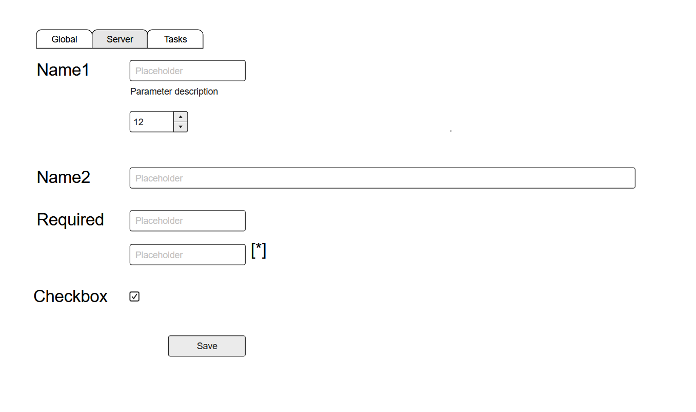

## Раздел Settings (конфигурация)

### UI

Структурный прототип: 

Названия Global/Server/Name1/Name2 на схеме условные. Текущие вкладки: `Remote server`, `Agent`, `Board`, `Git proxy`, `Tasks`, `HTTP proxy`. Форма ограничена 1180px; группы разделены тонкими линиями, названия имеют размер 17px. На ширине до 560px названия располагаются над полями, поля занимают доступную ширину, вкладки прокручиваются горизонтально. Save находится справа. Цвета и шапка — [main_ui.md](main_ui.md).

Две колонки:
- колонка названий групп полей конфигурации
- колонка полей

Вкладки сверху: переключают разделы конфигурации

Name1, Name2, Required, Checkbox - названия группы полей конфигурации.

Каждая группа может содержать несколько полей (может содержать одно, как Name2).

Типы полей:
- string (однострочный input)
- password (однострочный input типа password)
- integer (однострочный input, только целые числа)
- text (textarea с ручным изменением высоты, минимум 86px; ширина 50% своей области, не более 460px; `big` — 90%, на мобильной ширине — вся доступная ширина)
- checkbox

Дополнительные параметры для полей:
- для типа string: может иметь подтип small (по-умолчанию, короткое поле), может иметь подтип big (размер на 90% своей колонки)
- для всех типов, кроме checkbox: подтип required - поле обязательно для заполнения, в UI необходимо пометить символом `*`
- Красная звёздочка обязательности располагается снаружи справа от поля с отступом 8px, на уровне первой строки. Положение привязано к фактической ширине поля, включая textarea и подтип big; звёздочка не перекрывает текст, числовые стрелки и область изменения размера. На мобильных экранах под неё резервируется место без горизонтального переполнения.

Кнопка Save валидирует и сохраняет значения.

### Проверка обязательных полей

Сетку полей Settings ограничивать селектором `.settings-form`: общий класс `.field-control` также используется формой задачи и не должен получать двухколоночную раскладку настроек.

Регрессионный браузерный тест: `node tests/settings_required.js` (Playwright и Python3 с Jinja2). Проверяет шесть вариантов полей на ширинах 320–1440px, расположение звёздочек вне полей и сохранение required-валидации. Дополнительно проверяет изоляцию формы создания/редактирования задачи: поля сохраняют полную ширину, подписи находятся сверху, ошибки снизу, видимость статуса не переопределяется стилями Settings.

### Алгоритм работы

**Управление отображением страницы**

Каждая стандартная вкладка ("секция" конфигурации) управляется метаинформацией полей через файлы из папки [ui](../settings/ui). Пример файла: [remote_server.json](../settings/ui/remote_server.json)

Исключение — последняя вкладка `HTTP proxy`: она регистрируется отдельно, не имеет файла метаданных и использует вложенную конфигурацию и кастомный обработчик `settings/http_proxy.py`. Общий сервис направляет чтение, валидацию и сохранение этой секции в обработчик до обработки стандартных полей. После успешного Save методы и паттерны работающих прокси применяются сразу; добавление/удаление и изменение port, remote URL, timeout требуют перезапуска. Toast различает эти результаты. Подробности — [http-proxy.md](http-proxy.md).

Название вкладки - поле `title`

Группы полей конфигурации в массиве `groups`. `groups[].title` - Название конкретной групппы (левая колонка UI).

`fields` - поля конфигурации:
- `id` - идентификатор поля внутри секции конфигурации
- `type` - тип поля
- `required` - признак обязательности
- `description` - описание поля
- `sub_type` - подтип поля
- `title` - помещается в placeholder для полей типа string, password, integer, text; для поля checkbox выводится справа от визуального checkbox
- `default` - значение по-умолчанию

*Сохранение параметров конфигурации*

При сохранении конкретный раздел конфигурации после успешной валидации сохраняется в файл, соответствующий имени файла из [ui](../settings/ui) в папку [user](../settings/user) (с перезаписью).

Формат файла в папке [user](../settings/user) JSON, с ключами, соотвествующими `groups[].fields[].id`:
```json
{
  "field_name1": "text value",
  "field_name2": 12,
  "field_checkbox": true
}
```

При открытии Settings читаются JSON-метаданные из [settings/ui](../settings/ui). `remote_server` идёт первым, остальные стандартные секции сортируются по имени файла; последней добавляется HTTP proxy. Параметр `?section=<key>` выбирает вкладку; без него или с неизвестным ключом открывается первая. Сохранённые значения берутся из соответствующего файла [settings/user](../settings/user); для отсутствующих ключей используется `default`, затем пустая строка (для checkbox — `false`).

**Валидация**

- Для type == integer проверяем что введено корректно int значение больше или равно 0. JSON boolean, дробные числа и контейнеры отклоняются, а не преобразуются через округление; строка целого числа допустима.
- Если поле required - проверяем что оно не пусто, а для type == integer что значение строго больше 0

**Дополнительная валидация для разделов**

*Remote server*

В файле [remote_server.py](../settings/validation/remote_server.py) добавь логику:
- Должно быть обязательно заполнено одно из полей: `password`, `ssh_key`
- Валидация подключения SSH: выполнить подключение по переданным реквизитам и адресу сервера с запуском команды из параметра id: `test_shell`
- Поддерживаются hostname/IP без порта (22), `host:port`, bare IPv6 и `[IPv6]:port`; диапазон порта 1–65535.
- Использовать известные host keys и RejectPolicy; при заданном SSH-ключе не использовать пароль и не подбирать ключи из окружения.
- Команда проверки ограничена 10 секундами, stdout и stderr вычитываются без накопления; при таймауте канал и соединение закрываются. Ошибки возвращают безопасное сообщение без stderr, пароля и содержимого ключей.
- Регрессии конфигурации и SSH проверяются в `tests/test_settings_regressions.py` без реальных подключений.

**Работа с конфигурацией**

Нужен сервисный слой, который позволит использовать сохраненные значения конфигурации.

Пример вызова:
```python
Config.get('config_section.parameter_name1')
```

Если 'config_section.parameter_name1' не сохранен в соотвествующем [user](../settings/user), то:
1. Если в описании параметра (в соотвествующем [ui](../settings/ui)) есть default значение - вернуть его
2. Если default значения нет - вернуть None

### Tasks: инициализация каталога

`Base directory` — обязательное поле родительского каталога задач. Для выполнения и удаления требуется абсолютный POSIX-путь; Save проверяет только заполненность и обрезает внешние пробелы, не проверяя абсолютность или существование каталога. Относительный непустой путь сохраняется, но отклоняется при запуске/удалении задачи. Настройка сохраняется как `tasks.base_dir` и доступна для изменения. Init и агент всегда выполняются с `cwd` `<tasks.base_dir>/<TASK-ID>` по [agent.md](agent.md); местоположение файла скрипта не меняет cwd.

Описание и вложения находятся в подкаталоге `requirements-${TASK_ID}` этой рабочей папки. Например, при Base directory `/home/user/tasks` и ID `PRJ-12` описание доступно как `/home/user/tasks/PRJ-12/requirements-PRJ-12/TASK.md`. Init, которому нужны требования или вложения, должен обращаться к `requirements-PRJ-12/TASK.md` и `requirements-PRJ-12/<имя-файла>` относительно своего cwd. Полный контекст переносится до выполнения Init.

Путь каталога требований и английская стартовая инструкция формируются приложением по [agent.md](agent.md). `agent.prompt` (System append prompt) добавляется в начало `TASK.md`; это отдельное значение, оно не заменяет стартовую инструкцию ACP. Новые поля настроек для каталога требований не добавляются.

Поля секции Tasks:

| Ключ | Тип | Назначение |
| --- | --- | --- |
| `tasks.base_dir` | `string`, required | Родительский каталог для создания папок задач |
| `tasks.init_script_path` | `string`, подтип `big` | Путь к скрипту на удалённой машине |
| `tasks.init_script_text` | `text` | Содержимое скрипта |
| `tasks.init_script_timeout` | `integer` | Таймаут Init, общий для обоих способов задания скрипта |
| `tasks.logs_max_age` | `integer`, default `86400` | Максимальный возраст локальных логов сессий в секундах; поле Log retention |

`tasks.logs_max_age` — целое число ≥ 0. При старте приложения удаляются обычные файлы непосредственно в `data/logs`, у которых время последнего изменения строго раньше `текущее время − logs_max_age`. Значение `0` удаляет все файлы старше момента проверки, а не отключает очистку. В старой конфигурации применяется default `86400` (сутки). Save сохраняет параметр; очистка с новым значением выполняется при следующем старте приложения. Скрытые служебные файлы, подкаталоги и символические ссылки пропускаются.

Следующие правила относятся к `init_script_path` и `init_script_text`, а не к Base directory:

- Путь и текст Init необязательны, default — пустая строка. Отсутствующие ключи в старой конфигурации означают отключённый Init.
- Заполнено либо одно из этих двух полей, либо ни одного. Одновременное заполнение — ошибка валидации.
- Значения из одних пробельных символов считать пустыми при проверке взаимоисключения. Непустой текст скрипта сохранять без обрезки отступов; у пути удалять внешние пробелы.
- Если оба поля пусты, Init пропускается.
- Абсолютный путь использовать напрямую. Относительный путь разрешать от домашнего каталога SSH-пользователя, как путь с начальным `~/`; явно заданное `~/` раскрывать в тот же домашний каталог. При Save и выполнении применять одинаковое разрешение пути независимо от `cwd` задачи. Пробелы и shell-символы внутри имени считать буквальными, переменные и шаблоны не раскрывать; путь передавать как один аргумент, а не shell-команду.
- Если путь заполнен, при Save подключиться к удалённой машине по сохранённым настройкам Remote server и проверить, что файл существует по указанному пути. Недоступность сервера или отсутствие файла — ошибка валидации, секция не сохраняется. Скрипт при Save не выполнять. Не добавлять обязательную проверку права исполнения или синтаксиса скрипта.
- Взаимоисключение проверять до SSH-обращения. Для пустого пути SSH-проверка этих полей не требуется. Применять общие правила ошибок и Spinner из [settings.md](settings.md) и [main_ui.md](main_ui.md).
- Исполнитель получает согласованный снимок настроек при захвате задачи. Save влияет на последующие запуски. При повторе неуспешного Init брать новые настройки; для файлового варианта запускать актуальное содержимое файла, чтобы его исправление позволяло повторить Init.

`tasks.init_script_timeout` — обязательное положительное целое число секунд, default `300`, общий лимит обоих способов задания Init. Ноль не отключает таймаут; в старой конфигурации используется default. Если оба источника скрипта пусты, Init отключён.

Проверка непустого пути выполняется через SFTP и требует обычный файл. При проверке и выполнении используется один resolver пути, независимо от cwd задачи. Проверка при Save не гарантирует наличие или доступность файла при последующем запуске; такие ошибки обрабатываются как ошибки Init по [agent.md](agent.md).

Save записывает JSON атомарной заменой под межпроцессной блокировкой; исполнитель читает согласованный снимок всех настроек и захватывает задачу под той же блокировкой. Изменения влияют на следующий запуск, включая повтор неуспешного Init.

Save сохраняет введённый `base_dir` вместе с полями Init. Пустое значение не допускается; внешние пробелы удаляются. Изменение Base directory не переносит существующие каталоги задач; повтор использует проверки принадлежности каталога из [agent.md](agent.md).

### Нормализация и password-поля

Строковые значения при Save обрезаются по краям, кроме `tasks.init_script_text`. Это относится и к `agent.prompt`, password и token; сохранённый `agent.prompt` затем записывается в TASK.md без дополнительной обработки. Checkbox преобразуется через `bool(value)`; строгой проверки JSON boolean нет. Неизвестные поля не сохраняются стандартной формой.

Password-поля маскируются только визуально: сохранённое значение присутствует в HTML `value`, а успешный ответ Save возвращает `values`, включая секреты. Пустое значение не означает «сохранить прежнее»: оно проходит обычную валидацию. Это касается Remote server и Git proxy; правила выбора SSH-ключа и token — [git-proxy.md](git-proxy.md).

Вкладка Agent содержит `shell` (required, big), `agent_timeout` (required, default `7200`), `acp_wait_background_tasks` (checkbox, title `ACP wait background tasks`, default `false`), `acp_background_quiet_timeout` (integer, required, title `ACP background quiet timeout (seconds)`, default `60`) и `prompt` (required, text, default из метаданных). Checkbox расположен в группе Agent shell после таймаута; текст подписи находится справа от checkbox. Непосредственно после checkbox расположено поле таймаута тишины ACP, в секундах. Значение — положительное целое число (≥ 1); пустое, ноль, отрицательное, дробное и JSON boolean недопустимы. Save сохраняет JSON integer в `agent.acp_background_quiet_timeout`; отсутствующий ключ получает default `60` без миграции пользовательского JSON. Поле доступно и сохраняется независимо от состояния checkbox. Отсутствующий ключ `acp_wait_background_tasks` в старой конфигурации означает выключенный режим. Save сохраняет boolean в `agent.acp_wait_background_tasks`; согласованный снимок исполнителя применяется к следующему захвату задачи. Выключение во время активного запуска не меняет его снимок. При выключенном режиме SSH/ACP и перевод в REVIEW работают по прежним правилам. Включённый режим автоматически выбирает подтверждённые Qwen либо AIR (Claude/Codex) ACP-расширения и ждёт фоновые задания и обработку их результата по [agent.md](agent.md#опциональное-ожидание-фоновой-работы-acp). `continue_session_arg` не имеет поля формы: исполнитель читает его, если ключ заранее присутствует в `settings/user/agent.json`; обычный Save секции этот неизвестный ключ удаляет.

Ошибки серверной валидации стандартных настроек отображаются в Toast; обязательность и ограничения чисел дополнительно проверяются средствами браузера. Отдельных ошибок под каждым полем Settings нет.


### Проверка ACP wait background tasks — 2026-10-21

`tests/agent_background_ui.js` проверяет реальный Save и reload true/false на изолированных настройках, default off при отсутствующем ключе и отсутствие переполнения на 1357/375/320px. Desktop/mobile снимки визуально сверены с settings_proto.png и текущими текстовыми требованиями. `tests/settings_required.js` дополнительно прошёл без регрессий геометрии полей и обязательных звёздочек. Рабочие настройки не менялись.


### Настройка периода тишины ACP — 2026-10-21

Добавлено поле acp_background_quiet_timeout сразу после checkbox ожидания, в существующей группе Agent shell. Значение включено в снимок CONFIG_KEYS при claim. Настройка используется AIR backend Claude/Codex и не меняет Qwen conditional-close. Семантика — период без новой работы после завершения фоновых задач и финального хода; новые задачи/сообщения модели/вызовы инструментов сбрасывают отсчёт, общий agent_timeout не продлевается. При выключенном checkbox настройка не влияет на выполнение.

Проверки настройки: 64 passed в test_settings_regressions.py, test_agent_worker.py и test_agent_background.py с -W error. Playwright agent_background_ui.js проверяет default=60, положение после checkbox, number/min=1/step=1, ввод, integer Save/reload при обоих значениях checkbox, отказ для пустого/нулевого/отрицательного/дробного значения и серверный отказ для boolean. settings_required.js прошёл без регрессий. Форма визуально сверена с settings_proto.png и main_ui.md на 1357/375px; отсутствие переполнения дополнительно проверено на 320px. Временные снимки удалены, рабочие настройки и данные не изменялись.


AIR backend реализован: при включённом checkbox quiet timeout реально применяется после успешного хода/обработки учтённой фоновой работы. Поддержка определяется initialize capabilities без отдельного поля «тип агента». При выключенном checkbox таймаут не применяется. Подробнее — нормативный раздел agent.md; исторические результаты проверки одного поля выше сохранены.

Проверки подключения обработчиков: Agent settings и Board live прошли Playwright без изменений UI. Runtime-проверки Qwen/AIR и периода тишины описаны в agent.md; значение из этой формы теперь применяется AIR backend и остаётся частью общего agent_timeout.
