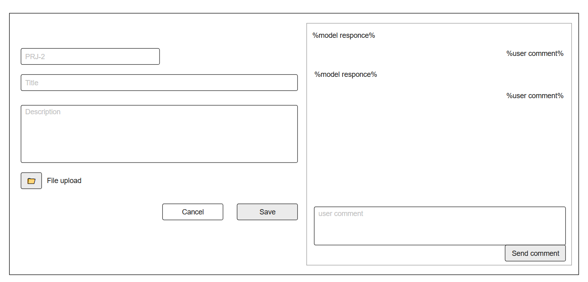

## Состояние и комментарии к задаче

См. прототип дизайна 

Виджет доступен для существующей задачи любого статуса, если есть сообщения; в BACKLOG/WAIT/REVIEW он виден и с пустой историей, поскольку содержит форму комментария. При создании задачи виджет скрыт. На ширине более 700px расположен справа от полей, на меньшей ширине — под ними. Схема PNG показывает расположение, а текущие сообщения имеют фон, дату и кнопку копирования.

Высота истории сообщений не должна увеличивать высоту формы задачи или вызывать прокрутку всего модального окна. На desktop правая панель ограничена высотой формы и доступной высотой окна; прокручивается только список сообщений, поле комментария и Send comment остаются под ним. Автопрокрутка изменяет только scrollTop списка сообщений, не прокручивает форму или страницу. На ширине до 700px панель под полями имеет ограниченную высоту и собственную прокрутку истории; прокрутка формы сохраняется для доступа ко всем полям на небольшом экране. Правило действует также на отдельной странице задачи.

При каждом открытии существующей задачи в модальном окне или на отдельной странице (в том числе в новой вкладке и после перезагрузки) после первой успешной загрузки истории область сообщений прокручивается к последнему сообщению независимо от его роли. Затем автопрокрутка выполняется при получении нового статуса агента или изменении его текста/даты-времени, независимо от текущей позиции прокрутки. Опрос без изменений, комментарии пользователя и смена состояния задачи сами по себе не запускают повторную автопрокрутку. Прокручивается только список сообщений, без смещения формы или страницы.

Сообщение "%model responce%" - это последнее актуальное сообщение от удаленного агента. В случае если задача IN PROGRESS - тут необходимо отбражать в реальном времении
последний ответ агента (пример формирования ответа см. в [test_remote_agent.py](../test_remote_agent.py)). В пределах одного ACP-промпта потоковые обновления заменяют текущее сообщение агента. Когда оркестратор отправляет дополнительный `session/prompt` для проверки фоновой работы (общий `FINAL_PROMPT` wrapper/AIR), предыдущий ответ сохраняется с прежними ID, текстом и датой, а ответ на новый промпт добавляется отдельным сообщением роли `agent` с тем же `run_id`. Каждый следующий дополнительный промпт создаёт такую же границу. Сообщение появляется только при непустом ответе; пустых записей ожидания нет. Совпадающие тексты разных ходов сохраняются отдельно. При отправке комментария и перезапуске задачи все сообщения предыдущих запусков сохраняются. Новый запуск формирует отдельный статус; история отображается в порядке создания сообщений, включая комментарии пользователя. Для каждого сообщения отображается дата-время его последнего обновления в формате `ГГГГ-ММ-ДД ЧЧ:ММ`.

Сообщение "%user comment%" - комментарий пользователя из поля ввода "user comment". Поле User comment в обеих формах изначально вмещает две строки текста. По мере ввода, вставки текста и переноса строк оно автоматически растёт до 170px (прежняя высота поля), затем прокручивается внутри. При удалении текста поле уменьшается до двух строк; после успешной отправки и при повторном открытии задачи высота сбрасывается. Изменение ширины окна пересчитывает высоту по переносу текста. Ручное изменение размера отключено. Поле ввода комментария отображается только в статусах:
- REVIEW
- WAIT
- BACKLOG

При Save существующей задачи не очищать неотправленный комментарий: сохранять его точный текст и пересчитывать высоту поля в модальном окне и на отдельной странице. Повторный Save также сохраняет текст и не отправляет его в чат. Успешный Send comment очищает поле по прежним правилам; закрытие формы и открытие задачи заново не восстанавливает этот черновик. Проверки — `tests/task_draft.js`.

Комментарий пользователя также содержит дату-время отправки в формате `ГГГГ-ММ-ДД ЧЧ:ММ`.
В форме редактирования REVIEW нет кнопки REOPEN: для переоткрытия пользователь отправляет в чате комментарий с причиной возврата на доработку.
При нажатии "Send comment" комментарий сохраняется и обновляется история. Из WAIT/REVIEW задача переводится в OPEN. В BACKLOG статус не меняется: пользователь отдельно переводит задачу в OPEN через Save или перенос карточки. При следующем захвате последний сохранённый комментарий передаётся агенту; само заполнение поля без Send comment ничего не отправляет.
Алгоритм повторного запуска определяется наличием сохранённой агентской сессии, а не только комментария:
- При наличии `sessionId` выполнить ACP `session/load`; пользовательский комментарий передать в `session/prompt`. `${PROMPT}` в shell необязателен и заменяется одним экранированным аргументом только при наличии; `continue_session_arg` добавляется только при существующей сессии, если настроен.
- Если `session/load` явно сообщает об отсутствующей сессии, один раз создать новую в том же запуске и передать стартовую инструкцию прочитать требования вместе с текущим комментарием. Сохранить новый `sessionId`; успешное восстановление не переводит задачу в WAIT и не добавляет ошибку в чат. История предыдущих запусков сохраняется. Подробные условия и обработка прочих ошибок — [agent.md](agent.md#первый-запуск-и-повтор).
- После ошибки Init агентской сессии ещё нет: повторить неуспешный Init по новым настройкам, затем выполнить `session/new` без `continue_session_arg`. Промпт объединяет английскую инструкцию прочитать `requirements-${TASK_ID}/TASK.md` и комментарий.
- Переиспользовать безопасный учтённый каталог, не перезаписывая `TASK.md` и вложения; неизвестный каталог первого запуска отклонять. Полные правила — [запуск задачи](agent.md).

Последовательные `agent_message_chunk` накапливаются в текущий ответ; перед callback текст очищается от известных секретов и их неполного суффикса. `agent_thought_chunk`, `user_message_chunk`, `tool_call` и `tool_call_update` сбрасывают буфер текущего ответа, поэтому следующая последовательность заменяет ответ текущего ACP-промпта. Сам сброс буфера инструментом/мыслью или автоматическим продолжением не создаёт нового сообщения. Граница отдельного сообщения фиксируется только при дополнительном `session/prompt` оркестратора; Qwen и выключенное ожидание сохраняют прежнее поведение. Thoughts/stderr в callback не передаются. Полный журнал БД санитизируется отдельно; сырые файловые логи ACP не санитизируются — см. [agent.md](agent.md#диагностика-и-сырые-логи).

При `session/load` удалённый агент может повторно передавать историю через `session/update`. Эти события сохраняются только в диагностическом журнале, не вызывают callback чата и не накапливаются в буфере нового ответа. До первого ответа на новый `session/prompt` новый запуск не создаёт сообщения агента, в том числе если после загрузки ответа не было или загрузка завершилась ошибкой отсутствующей сессии. Предыдущие сообщения и их даты сохраняются. Совпадение текста настоящего нового ответа с предыдущим не является основанием скрывать его; фильтрация определяется этапом ACP, а не сравнением строк. Исправление предотвращает новые дубли, уже сохранённую историю не изменяет.

Обновление Board выполняется SSE polling-снимками каждые 500ms; task chat остаётся отдельным endpoint GET/POST `/api/board/tasks/{task_id}/chat`. Комментарий принимается атомарно для `BACKLOG`/`WAIT`/`REVIEW`; BACKLOG сохраняется, WAIT/REVIEW переводятся в OPEN. Недопустимый статус возвращает 409, некорректный комментарий — 422. Ошибка агента переводит задачу в `WAIT` с признаком ошибки.

### Ошибки и вывод Init

- При ошибке Init добавлять отдельное системное сообщение `Init script error` с `run_id` и датой-временем в формате чата `ГГГГ-ММ-ДД ЧЧ:ММ`. Сохранять его при последующих попытках, не заменять ответом агента и не дублировать при опросе.
- Диагностику выбирать в порядке: непустой stderr → непустой stdout → `Init script error: <exit_code>`, если оба потока пусты.
- Если код выхода недоступен, указывать фактическую причину: таймаут, разрыв SSH или невозможность запуска; не подставлять выдуманный код.
- Если процесс завершился с кодом `0` до PID-handshake, показывать `Init script error: process exited before startup handshake`; это ошибка протокола запуска, а не ошибка скрипта с нулевым кодом.
- Читать stdout и stderr параллельно, отдельно от ACP. Сохраняемый объём каждого потока ограничить 64 КиБ, при превышении явно отмечать усечение. Это заменяет исходное требование показывать «весь stdout».
- Перед сохранением и показом удалять известные секреты, включая секреты на границах порций данных и границе усечения. Вывод отображать как текст, не HTML.

Системное сообщение имеет роль `system`; отображение использует `textContent` с сохранением переносов строк, без интерпретации Markdown. Успешный Init не добавляет сообщения в чат: его безопасный диагностический вывод остаётся только в журнале запуска.

### Отмена агента

После ручного перевода IN PROGRESS → BACKLOG и завершения остановки сохранять системное сообщение `Remote agent cancelled.` с `run_id` и датой. При неподтверждённой остановке добавлять `Remote stop unconfirmed; retry blocked pending verification.`; очередь блокируется до проверки оператором. Сообщения отображаются существующим текстовым представлением роли `system` и сохраняются после перезагрузки. Поздние `agent_message_chunk` отменённого запуска не заменяют историю ответа. Статус остаётся BACKLOG; поле комментария доступно сразу после перехода, включая время асинхронной остановки. Отправка комментария не запускает агента и не снимает блокировку очереди. Предел ожидания ACP — 60 секунд; полный порядок — [agent.md](agent.md#ручная-отмена-acp-in-progress--backlog).

### Конфликт каталога требований

Если при первой подготовке уже существует `requirements-${TASK_ID}`, задача переходит в `WAIT` с признаком ошибки. В чат сохраняется `Task directory requirements-${TASK_ID} already exists.` с фактическим ID, датой и run_id; сообщение остаётся после перезагрузки и последующих попыток. Init и ACP не запускаются. Подготовленный и учтённый контекст при повторе из `WAIT` переиспользуется без перезаписи; неизвестный или частично подготовленный контекст не переиспользуется.

Пример сообщения для задачи `PRJ-12`:

```text
Task directory requirements-PRJ-12 already exists.
```

Это ошибка подготовки контекста, поэтому к тексту не добавляется префикс `Init script error`. В БД она сохраняется с ролью `agent` и отображается общим Markdown-рендерером; специального plain-text режима для этого сообщения нет. После `Send comment` история ошибки сохраняется; сам комментарий не разрешает перезапись конфликтующего каталога. Полные условия повтора — [agent.md](agent.md#первый-запуск-и-повтор).

### Рендеринг и доставка сообщений

Markdown-цитаты (`> текст`) в сообщениях пользователя и агента явно выделять фиолетовой полосой слева толщиной 4px (`#7161e8`), светлым фоном `#f1edff`, тёмным текстом `#494357` и внутренними отступами 8px по вертикали / 12px по горизонтали. Правые углы скруглены на 6px; внешние отступы — 10px по вертикали и 0 по горизонтали. У первого и последнего дочерних элементов цитаты убрать крайние вертикальные отступы. Многострочные и вложенные цитаты сохраняют обычный Markdown и переносят длинный текст без расширения сообщения или формы на мобильном экране. Стиль ограничен телом сообщения и одинаков в модальном окне, на отдельной странице, в архивном просмотре и HTML-экспорте. Символ `>` внутри inline/fenced code остаётся кодом; роль `system` остаётся обычным текстом.

Markdown-таблицы в сообщениях имеют тонкие границы ячеек, внутренние отступы, выделенную шапку и чередующийся фон строк. Ячейки выровнены по верхнему краю; заданное в Markdown выравнивание столбцов сохраняется. Широкая таблица прокручивается горизонтально внутри сообщения, не расширяя чат или форму задачи, в том числе на мобильном экране. Стили ограничены телом сообщения и применяются в модальном окне и на отдельной странице.

Чат получает GET `/api/board/tasks/{task_id}/chat` при открытии и затем через 500 мс после завершения предыдущего запроса; это отдельный polling, не SSE. Во время Spinner новые данные откладываются. Закрытие формы отменяет текущий запрос. Поле комментария ограничено 32000 символами, пробелы по краям удаляются; Send comment использует Spinner и блокирует форму.

`agent` и `user` отображаются через локальный `marked.umd.js` с `breaks: true` и отдельный `static/js/safe-markdown.js`. HTML-токены экранируются (`&`, `<`, `>`, двойные и одинарные кавычки), поэтому исходные теги, обработчики событий, script/SVG/iframe выводятся текстом. Экранировать только HTML-токены, сохраняя обычный Markdown, таблицы и точное содержимое inline/fenced code без двойного экранирования. Перед добавлением фрагмента в DOM проверять декодированные href/src: ссылки допускают HTTP, HTTPS, mailto и относительные адреса; изображения — HTTP, HTTPS и относительные адреса. Недопустимые или некорректные адреса удаляются, включая javascript, vbscript и data. Правила действуют также для ранее сохранённых сообщений, ответов агента и архивного просмотра. При отсутствии Markdown-рендерера выводить безопасный текст через textContent. Роль `system` всегда выводится через `textContent` и `white-space: pre-wrap`. Кнопка `Copy message as Markdown` копирует исходный текст без HTML-кодирования и сообщает успех/ошибку в Toast.

Ошибка Init, явная отмена и неподтверждённая остановка создают сообщение `system`. Обычная ошибка подготовки/SSH/ACP записывается с ролью `agent`; если ответ текущего ACP-промпта уже существует, ошибка добавляется к нему через пустую строку. Если дополнительный промпт не дал ответа, его ошибка создаёт отдельное сообщение; ответы предыдущих промптов и их даты не меняются. Поэтому диагностика обычного сбоя также отображается Markdown-рендерером. Сообщения агента и system расположены слева на сером фоне, пользователя — справа на голубом.

На отдельной странице на desktop чат растягивается вместе с формой на свободную высоту окна; дополнительная высота увеличивает область истории, а User comment сохраняет автоувеличение от двух строк до 170px. На мобильной ширине чат остаётся под полями с собственной ограниченной высотой.

Регрессионные тесты интерфейса — `tests/chat_scroll.js`, `tests/html_escaping.js`.

### Экспорт чата в HTML

- В обеих формах существующей задачи показывать кнопку `Export HTML` в общей нижней строке действий под полем комментария, вместе с `Clear context` и `Send comment`. Экспорт прижат к левому краю, остальные действия — к правому; при нехватке ширины кнопки переносятся без горизонтального переполнения. Строка находится вне скрываемого поля комментария: экспорт остаётся доступным в статусах без комментариев, включая DONE и ARCHIVE, если история непустая, а `Clear context` и `Send comment` скрываются. При создании задачи чат и кнопка скрыты; до загрузки сообщений и при пустой истории кнопка отключена.
- Нажатие скачивает `<TASK-ID>-chat.html`: самостоятельный UTF-8 HTML со встроенными стилями, без JavaScript, сборки и внешних ресурсов. Файл открывается через `file://` без сервера и подключения к сети; на узких экранах текст переносится, код и широкие таблицы прокручиваются внутри сообщения.
- Включать ID и сохранённое название задачи, всю историю последнего успешно отображённого GET/POST chat в исходном порядке, роли Agent/User/System и даты последнего обновления в формате чата. Экспортировать также сообщения за пределами видимой области прокрутки и ответы разных ACP-промптов с одинаковым run_id. Последующие обновления polling попадают в следующий экспорт.
- Agent/User сохраняют безопасный Markdown, оформление цитат, таблицы и точный текст code-блоков через общий safe-markdown.js. System и fallback остаются plain text с переносами строк; название задачи выводится текстом. Недопустимые URL не становятся ссылками. Изображения заменяются ссылками с alt-текстом, относительные адреса преобразуются в абсолютные адреса приложения; файл не запрашивает изображения при открытии.
- Экспорт использует загруженный снимок без дополнительных HTTP-запросов. Он не меняет статус, сообщения, поля, файлы и неотправленный комментарий; копирование отдельных сообщений и элементы формы в файл не включаются. Общий Spinner блокирует кнопку вместе с остальной формой; ошибку формирования или скачивания показывать стандартным error Toast `Unable to export chat`.
- Логика — отдельный `static/js/task-chat-export.js`, обычный script после safe-markdown.js и до task-chat.js на Board и отдельной странице задачи. Проверки — `tests/task_chat_export.js`: реальное скачивание, открытие офлайн через file://, полная история/роли/даты/Unicode/Markdown, безопасная разметка, обновления, DONE/ARCHIVE, пустой чат и черновики в обеих формах на 1459/700/375/320px. Скриншоты для визуальной сверки доступны через `CHAT_EXPORT_SCREENSHOTS`; после проверки временные файлы удалять.

### Сброс контекста агента

- В модальном окне и на отдельной странице задачи показывать `Clear context` непосредственно слева от `Send comment`, только когда GET chat возвращает `can_clear_context: true`. Доступные сохранённые статусы — BACKLOG, WAIT и REVIEW; нужна ранее созданная ACP-сессия после последнего сброса. Создание задачи, OPEN, IN PROGRESS, DONE и ARCHIVE кнопку не показывают. Несохранённый dropdown не меняет доступность.
- Активный PREPARING/RUNNING этой задачи, включая асинхронную остановку после Stop, и любой её `init_uncertain`/`agent_uncertain` блокируют сброс. Кнопка не заменяет Stop или Agent Recovery.
- Нажатие отправляет POST `/api/board/tasks/{task_id}/clear-context`. Включать общий Spinner с текстом `Clearing…`, блокировать всю форму, повторные запросы и закрытие окна до ответа. Подсказка кнопки объясняет создание новой сессии при следующем запуске и сохранение файлов/чата.
- Успех оставляет текущий статус, поля, вложения, несохранённый комментарий и всю историю. Добавляется одно датированное системное сообщение `Agent context cleared. The next run will start a new session.`; Toast — `Context cleared. The next run will start a new session.`. Кнопка скрывается до создания следующей ACP-сессии. Повтор запроса до новой сессии не добавляет дубликат.
- Сброс сохраняет границу возобновления в БД, не отправляет `/clear` как текст модели и не выполняет SSH/ACP из HTTP. При следующем обычном запуске использовать `session/new` вместо старого `session/load`, передать стартовую инструкцию и последний сохранённый комментарий по общим правилам. Файлы рабочей папки и успешный Init сохраняются. Полный контракт — [agent.md](agent.md#ручной-сброс-acp-контекста).
- Ошибки отображать стандартным Toast; форма и черновики остаются открытыми, Spinner снимается в finally. Опрос после операции восстанавливается и обновляет доступность по сохранённому состоянию.
- Регрессионные тесты — `tests/task_context_ui.js`, `tests/test_task_session.py`.
